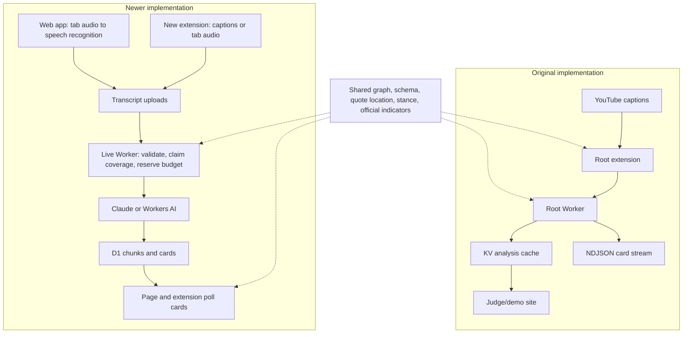

# Lastro codebase guide

Initially inspected on 2026-11-12 at commit `b5c2ac2`; updated for X ticket 04 in the working tree based on `725c0c3`. This is a source-backed snapshot. Recheck the linked code when changing behavior; build success and recorded evaluations establish only the checks described below.

## What the product does

Lastro helps a viewer understand economic and political claims in a YouTube video. It places context cards on the playback timeline: the speaker's claim, its intellectual background, opposing views, relevant Brazilian episodes, readings, and comparisons with official figures. A theory or forecast has no truth verdict. Numerical comparisons use official data and say whether values match or differ.

The newer extension also offers X context on home timelines, individual post pages, search results and profile feeds. An explicit click on a relevant Portuguese post opens attributed context beneath that post, reusing compatible server results across viewers. This preserves authored text, has no playback controls and compares supported numerical claims when their date and observation can be resolved conservatively. Live X DOM compatibility is not yet verified.

Read the [domain glossary](../GLOSSARY.md) for the product language. There are two executable implementations in this repository. They share domain code but have different ingestion, persistence, and delivery contracts.

| Area | Original implementation | Newer live implementation |
| --- | --- | --- |
| User surfaces | Root Chrome extension and judge/demo site | Web app, landing/privacy pages, and another Chrome extension |
| Entry points | [`extension/src/content.ts`](../extension/src/content.ts), [`site/src/demo.ts`](../site/src/demo.ts) | [`webapp/src/web/main.ts`](../webapp/src/web/main.ts), YouTube [`content.ts`](../webapp/extension/src/content.ts), X [`x-content.ts`](../webapp/extension/src/x-content.ts) |
| Backend | [`worker/src/index.ts`](../worker/src/index.ts) | [`webapp/src/worker/index.ts`](../webapp/src/worker/index.ts) |
| Input | A video's captions | Live recognized speech, captions, or selected complete authored X post text |
| Analysis | One streamed Claude call for the supplied transcript | Calls per video chunk or selected post; Claude first, Workers AI fallback |
| Persistence | Cloudflare KV, keyed by video + transcript hash + prompt version | Cloudflare D1: video coverage/cards and separate post results |
| Delivery | NDJSON stream and cached results | Video card polling; post request returns its completed result |
| Default local port | 8787 | 8788 |

The [newer app README](../webapp/README.md#chrome-extension) describes its extension as replacing the first extension for that app. Recent commits concentrate on this implementation. **Inference:** `webapp/` is the likely starting point for new product work. Whether both implementations must remain supported is still a maintainer decision.

## Trace the newer implementation

1. The page opens a video and polls stored cards. Language detection uses the video's original audio metadata, automatic captions, or title, with viewer/browser choices as fallbacks. See [`main.ts`](../webapp/src/web/main.ts), [`language.ts`](../webapp/src/worker/language.ts), and [`youtube.ts`](../webapp/src/web/youtube.ts).
2. Listening creates a video-bound session, captures tab audio, and uses Chrome speech recognition. [`transcriber.ts`](../webapp/src/web/transcriber.ts) maps recognized phrases to playback times. [`uploader.ts`](../webapp/src/web/uploader.ts) buffers final segments: first scheduled flush at 15 seconds, then every 30 seconds, or earlier at its character threshold.
3. The newer extension reuses the page's overlay, timeline, speech helpers, and uploader. It mounts into YouTube through a shadow root. Its page-world hook/panel readers obtain captions; [`captions.ts`](../webapp/extension/src/captions.ts) chunks uncovered captions and prioritizes the playhead. The background worker proxies requests to the configured backend. An offscreen document supports explicit tab-audio listening when captions are unavailable. See [`messages.ts`](../webapp/extension/src/messages.ts) for message contracts.
4. The live Worker validates and cleans segments, checks session lifetime and pacing, and claims coverage in D1. Coverage uses **10-second buckets of segment start times**, with `(video_id, bucket)` unique. These are approximate coverage markers, rather than a precise union of every segment's duration.
5. For newly claimed text, the Worker reserves daily dollars or neurons, then calls [`factcheck.ts`](../webapp/src/worker/factcheck.ts). The model receives new speech, preceding context, and recent recorded ideas. Validation locates each quote in the new transcript and constrains card fields. Cards can survive without a graph node or official indicator.
6. Fact cards with supported Brazilian indicators are checked against BCB/IBGE data in the Worker. The saved result includes the comparison and a thinned series for charts. A theory, unmatched indicator, or failed lookup can have no verdict. Quote location uses a normalized word-overlap heuristic in [`locate.ts`](../shared/locate.ts); it is not proof of exact sequence or of what was actually spoken.
7. Claude cards are saved as completed units arrive. Workers AI cards are saved after its response is parsed. The transcript endpoint holds its response open while processing and also registers the work with `waitUntil`. Card delivery to clients remains polling: roughly 3 seconds while active, 30 seconds while idle. Hidden-tab behavior allows continued polling while listening.

### Live interfaces and stored data

The contract types are in [`webapp/src/types.ts`](../webapp/src/types.ts); routing, validation, SQL, budgets, and chunk orchestration currently share [`webapp/src/worker/index.ts`](../webapp/src/worker/index.ts).

| Interface | Purpose |
| --- | --- |
| `GET /api/videos` | Public recent-analysis history, up to 24 videos |
| `POST /api/videos/:id/sessions` | Creates a 2-hour token for speech or captions ingestion |
| `POST /api/videos/:id/transcript` | Submits segments, processes newly claimed text, reports accepted/skipped counts |
| `GET /api/videos/:id/cards?after=<cursor>` | Up to 100 new stored cards per poll, cursor, recent chunk status, coverage estimate |
| `GET /api/videos/:id/coverage` | Merged bucket ranges, used to avoid resending captions |
| `GET /api/videos/:id/language` | Detects and caches spoken language |
| `POST /api/posts/analyze` | Validates a complete Portuguese public-post observation; reuses a compatible result or analyzes and saves `complete`/`empty`; competing requests receive 409 `in_progress` with Retry-After |
| `GET /api/posts/results/:id` | Retrieves one saved post result by its opaque result id; no public post-history listing |

Nine ordered [SQL migrations](../webapp/migrations/) define:

| Table | Responsibility |
| --- | --- |
| `videos` | Metadata, cached language, analysis counters, history timestamp |
| `chunks` | Accepted text, processing state, provider, recorded usage/error |
| `coverage` | First claimant for each video/time bucket |
| `cards` | JSON card payloads with video, chunk, start time, and increasing id |
| `sessions` | Hashed token, video, source, hashed connection, pacing counters |
| `daily_videos` | Tracks first analysis of each video on each UTC day and connection attribution |
| `usage_daily` | Daily reserved/settled dollars and neurons |
| `transcript_log` | Cleaned uploads and their outcomes for investigation |
| `post_results` | Migration [`0008_posts.sql`](../webapp/migrations/0008_posts.sql): authored source metadata/text, successful cards or explicit empty outcome, opaque result id and analysis time |
| `post_analysis_keys` | Migration [`0009_post_reuse.sql`](../webapp/migrations/0009_post_reuse.sql): post identity, server text/metadata fingerprints, contract version, successful result reference and temporary attempt lease |

Video ingestion is a shared-video system. There is no implemented user account or personal library. Sessions authorize ingestion for a video; they do not establish transcript provenance. The first accepted transcript for a covered bucket becomes the shared input even if another viewer would supply different text. Post requests create no video, session, coverage, transcript-log or public recent-history rows. Post reuse is shared across viewers, with no viewer identifier in its lookup key.

Cleanup for expired sessions, previous daily-video records, and old transcript-log rows runs when creating a session. `LOG_RETENTION_DAYS` applies to `transcript_log`; `chunks.segments` also retains accepted text, with no corresponding age-based deletion in this Worker. A retention change must account for both stores.

### Trace the X post interaction

1. [`x-content.ts`](../webapp/extension/src/x-content.ts) observes top-level rendered post articles independently of the current URL. Home, detail, search and profile use the same extraction/action/panel pipeline. Each action selects its own article; embedded quote cards, nested articles, adjacent post text, media and surrounding controls are excluded. Written inline emoji and line breaks are retained. A truncated post waits for viewer expansion.
2. The local Portuguese relevance gate combines the committed [`TopicScorer`](../shared/topics.ts) with conservative subject/assertion guards. It sends no requests. A recognized author header, matching author handle/permalink and a timestamp element are required, and observed protected markers suppress the action. Missing source information produces a notice rather than implying public status. These selectors are browser observations, not platform attestation; live validation remains required.
3. A Lastro click re-reads the selected source and sends `PostSource` through the existing extension [`background.ts`](../webapp/extension/src/background.ts) API transport. The Worker validates identity, completeness/public-state declarations, text bounds and canonical publication timestamp without speech cleaning. Publication time can be null in the request contract.
4. [`post-cache.ts`](../webapp/src/worker/post-cache.ts) hashes exact complete text and metadata (including publication time or its absence) on the server. The post identity, both fingerprints and server-owned `ANALYSIS_VERSION` identify a compatible result. Successful cards and explicit empty results are returned before provider reservations, even if new inference is unavailable. Earlier unversioned results remain readable by opaque id but are not assumed compatible. Bump this version when extraction, validation, graph context or numerical-comparison semantics change.
5. On a miss, an atomic D1 claim permits one attempt per compatible revision. Duplicate requests receive 409 `in_progress` with a two-second Retry-After hint. Failed attempts release their claim; an interrupted Worker can be retried after a three-minute lease. Attempt tokens fence late responses and releases, and a D1 batch publishes the result and its lookup together. A lease only controls unfinished work; successful results do not expire. Different text or metadata revisions proceed independently without overwriting each other.
6. [`posts.ts`](../webapp/src/worker/posts.ts) supplies an authored-post extraction prompt and validates model units, including exact substring quote grounding and known graph nodes/roles. Claude is attempted first when configured and its shared daily dollar reservation succeeds; Workers AI uses the existing shared neuron cap. Unknown failed-call usage keeps its reservation. A malformed/truncated response or nonempty response with no grounded cards fails rather than becoming a saved empty result.
7. [`post-comparisons.ts`](../webapp/src/worker/post-comparisons.ts) resolves supported official comparisons after extraction, independently of the model's proposed period. It uses grounded date wording and selects raw observations before thinning the chart. `ANALYSIS_VERSION` is now `post-v2`; earlier results cannot supply a new compatible request. Official lookup failure or its six-second deadline leaves the context card unchecked without retrying a paid model.
8. [`index.ts`](../webapp/src/worker/index.ts) persists only successful results in `post_results` and returns `PostAnalysis`. The panel distinguishes loading, cards, explicit empty, another request in progress, and failure; the latter two offer Retry. Shared [`cardview.ts`](../webapp/src/web/cardview.ts) supplies intellectual context, opposing views, episodes and readings; post cards have no timeline fields or seek control. Comparisons show value, source, observation period, available series and a notice that the series fetched now may contain revisions and does not establish what was available at publication. Interface labels follow the existing English/Portuguese selection. Closing removes the panel; reopening requests the server again. There is no durable browser result archive.

Mounted state belongs to the current article element, rather than a history of encountered post ids. DOM updates remove detached, moved, embedded, replaced or changed sources and their panels. The click and response paths both recheck source identity/text/metadata, so even a reply arriving before the next mutation refresh cannot attach to recycled text. A repeated content-script injection disposes the previous observer, actions and pending UI. Install/update injection follows each manifest entry's host matches and world, keeping the YouTube page hook and content script on YouTube and the X content script on X.

Post comparison date policy:

- Explicit dates in the grounded quote take precedence: ISO dates/months, Brazilian day/month/year, Portuguese named months (with optional day), numbered quarters and years. Multiple dates, invalid dates, unresolved date wording or a model-only date remain unchecked. Qualifiers such as `antes`, `depois`, `desde`, `até`, `após`, `a partir de`, relative intervals such as `faz um ano`/`há um ano`/`um ano atrás`, and partial-period wording such as `início de`/`meio de` are conservatively rejected across the source, even if the quote omits them. If the quote omits an explicit date elsewhere in the source, it cannot fall back to a relative comparison.
- Daily Selic/PTAX use exact days; broader daily months/years need end-of-period wording directly attached to that date (`fim de janeiro de 2020`, for example). An unrelated `fim de um mandato` cannot authorize a month-end comparison. A selected daily observation must be no later than the reference and at most seven days earlier. Monthly indicators require an explicit month; GDP requires an explicit quarter. A monthly year alone cannot establish an annual observation. Unemployment is a rolling quarter ending in the displayed month; GDP is change from the immediately preceding quarter.
- `hoje`, `agora` and `atualmente` use the publication's canonical UTC calendar day for daily series. Relative monthly/quarterly claims and Focus remain unchecked: the supported endpoints do not establish publication-time release/vintage information, and Focus's existing fetch targets the current year's expectations. Missing/future publication metadata, a future intended period, unsupported figures, theories and forecasts receive no numerical verdict. Impossible DOM dates remain null rather than normalizing to another date.
- Post-only unemployment and GDP requests use explicit historical ranges through the [IBGE aggregate API](https://servicodados.ibge.gov.br/api/docs/agregados?versao=3), preserving the existing supported tables/variables. Read-only requests verified historical ranges and metadata for tables 6381/4099 and 5932/6564. The existing YouTube `resolveFact`, latest-N fetches and chart policy are unchanged. No observation here is an archived publication-time vintage or proof of intraday availability.

The conservative source-wide relative-word guard also rejects feminine/plural past forms (`passada`, `passadas`), `anterior`/`anteriores`, `seguinte(s)`, `próximo(a)` and plural variants, `retrasado(a)`, and relative days such as `anteontem`, `ontem` and `amanhã`. These words cannot silently become a publication-day comparison when a model quote drops them. This limited policy can leave otherwise useful numerical claims unchecked rather than interpreting broader natural-language date expressions. A targeted five-test Worker recheck and live typecheck passed after this guard expansion; the preceding full Worker run remains 19/19.

Post text and metadata remain untrusted client input. Exact grounding establishes that a displayed quote occurs in the supplied text, not that X attests the source or that the claim is true. `post_results` has no automatic expiry in this slice.

### Integration boundaries

| Dependency | Where it connects | What to verify before changing it |
| --- | --- | --- |
| YouTube | IFrame player, page hooks/panel readers, Worker oEmbed/watch-page fetches | Playback clock, navigation/ad handling, missing captions, language metadata failures |
| X rendered pages | [`x-content.ts`](../webapp/extension/src/x-content.ts), extension manifest/background transport | Selected-post identity, author/public/protected observations, own text/quote exclusion, truncation, DOM changes and inline placement |
| Chrome speech/capture | Web transcriber, extension background/offscreen document | User gesture and permissions, language, interruption/restart, time alignment |
| Anthropic | Both Workers; newer video extraction in `factcheck.ts`, authored-post extraction in `posts.ts` | Structured output, streaming partial video results, quote validation, provider failure, usage settlement |
| Workers AI | Newer `factcheck.ts` and `posts.ts` | Alternative response shapes, truncation, neuron reservation, fallback exhaustion |
| BCB and IBGE | [`shared/indicators.ts`](../shared/indicators.ts), post-only [`post-comparisons.ts`](../webapp/src/worker/post-comparisons.ts) | Indicator meaning/unit, period selection versus release/vintage, comparison tolerance, missing/slow data |
| Cloudflare D1 | Live Worker and migrations | Uniqueness, concurrency, failure recovery, ordering/cursors, data migration |
| Cloudflare KV | Original Worker | Cache compatibility, prompt version, counters and pending keys |

Provider/model names and pricing in source describe this checkout's configuration. Their current availability, limits, and commercial prices were not independently verified during onboarding.

## Trace the original implementation

[`extension/src/content.ts`](../extension/src/content.ts) obtains captions via its hook/panel readers, classifies the video, hashes the transcript, and asks the background worker for a cache lookup. On a miss it requests analysis; a manual override can bypass topic rejection under a separate cap.

The root Worker independently checks the hash and topic, reads KV limits, calls Claude with [`shared/prompt.ts`](../shared/prompt.ts), validates located cards, and streams `meta`, `card`, `enrich`, `dropped`, `done`, or `error` events. Prompt `p9` adds context and counterpoints after units. Cached analyses replay as a stream. The original extension fetches official data in its background worker, with a six-hour in-memory cache.

The demo site reuses the original overlay with a YouTube IFrame player. Recorded demo cards ship as fallbacks; the live demo endpoint makes a fresh model call. Start from [`shared/demo.ts`](../shared/demo.ts), [`site/src/demo.ts`](../site/src/demo.ts), and the root Worker's `/api/demo/*` routes.

Important difference: original KV spending/daily/pending counters use read-then-write operations. They do not provide the live implementation's atomic SQL reservations. Treat concurrency and spending guarantees separately for each backend.

## Where changes belong

| Change | First files to read | Likely reach |
| --- | --- | --- |
| Add intellectual context or an opposing view | [`shared/kg.json`](../shared/kg.json), [`kg.ts`](../shared/kg.ts), [`stance.ts`](../shared/stance.ts) | Both implementations; model prompt context and rendered reading/opposition sections |
| Change card kinds or supported indicators | [`shared/schema.ts`](../shared/schema.ts), [`indicators.ts`](../shared/indicators.ts), both model validators | Both implementations, stored cards, output schemas, fixtures |
| Improve live extraction or add another model | [`webapp/src/worker/factcheck.ts`](../webapp/src/worker/factcheck.ts), live Worker budget/runner functions | Web app and newer extension |
| Change authored-post extraction or outcomes | [`webapp/src/worker/posts.ts`](../webapp/src/worker/posts.ts), [`post-cache.ts`](../webapp/src/worker/post-cache.ts), post routes in [`index.ts`](../webapp/src/worker/index.ts), [`types.ts`](../webapp/src/types.ts) | Post prompt/validation, analysis version, storage contract and Worker request/response tests |
| Change selected X post interaction | [`x-content.ts`](../webapp/extension/src/x-content.ts), shared [`cardview.ts`](../webapp/src/web/cardview.ts) | Local relevance/source observation, extraction, panel lifecycle and Chrome fixture checks |
| Change original extraction/enrichment | [`shared/prompt.ts`](../shared/prompt.ts), root Worker, `PROMPT_VERSION` | Original stream/cache and demo; shared schema changes can also affect live output |
| Change live card UI or popup timing | [`webapp/src/web/overlay.ts`](../webapp/src/web/overlay.ts), [`cardview.ts`](../webapp/src/web/cardview.ts), [`timeline.ts`](../webapp/src/web/timeline.ts) | Page and newer extension; original UI is a separate implementation |
| Change transcript ingestion/retries | [`uploader.ts`](../webapp/src/web/uploader.ts), extension [`captions.ts`](../webapp/extension/src/captions.ts), live Worker | Different pacing and coverage expectations for speech/captions |
| Change topic gating | [`shared/topics.ts`](../shared/topics.ts), both extension content scripts, root Worker | Client gating in extensions; server gating in original Worker; no equivalent topic gate in live transcript endpoint |
| Add persistent behavior | [`webapp/migrations/`](../webapp/migrations/), live Worker, [`types.ts`](../webapp/src/types.ts) | D1 migration, contract, and client behavior |

Existing useful test seams include `stanceView`, transcript parsing/quote location, `TranscriptUploader`'s `Transport`, the timeline's `PlayerAdapter`, and the Worker's request/response interface. The live Worker currently creates model/data dependencies internally and combines several responsibilities; introduce an interface only when the feature or a specific behavioral test needs it.

## Verified implementation state

The working tree was clean before the original onboarding inspection, which followed the newer extension/live-overlay merge on 2026-11-10. Tickets 01–04 subsequently added the authored-post path across four X surfaces, shared reuse, conservative official comparisons and deterministic tests described here. The implementation is a substantial prototype with buildable surfaces and shared-domain regression checks. Production readiness and hosted service health remain unestablished by this assessment.

Run from the root unless the command names a workspace:

| Check run during onboarding / X POC implementation | Result | What it establishes |
| --- | --- | --- |
| `pnpm install --frozen-lockfile` | Passed | Pinned workspace dependencies install with the existing lockfile |
| `pnpm run typecheck` | Passed | Root shared/Worker/scripts and original extension compile |
| `pnpm --filter lastro-live run typecheck` | Passed | Live Worker, web client, and newer extension compile |
| `pnpm run eval` | 770 passed, 0 failed | Stance, recorded model labels/enrichment, graph rules, synthetic transcript-panel parsing |
| `pnpm run build:ext` | Passed | Original extension bundles |
| `pnpm run build:site` | Passed | Original demo site bundles |
| `pnpm --filter lastro-live run build` | Passed | Live Worker and three web pages bundle |
| `pnpm --filter lastro-live run ext:build` | Passed | Newer extension bundles |
| `pnpm --filter lastro-live run db:local` | First seven migrations applied during onboarding; ticket migrations 0008 and 0009 subsequently applied | Local D1 schema migration; no remote database touched |
| `pnpm --filter lastro-live run test:posts` | 62 passed, 0 failed | Nineteen Worker/local-D1 tests, 42 isolated Chrome fixture/sample tests and one controlled extension install/update event test; no paid calls |

Root/live typechecks, shared evaluation, newer app build and newer extension build were rerun successfully after ticket 04. The original extension/site build rows record onboarding checks. The post command runs the bounded `test:posts:worker` suite first, then `test:posts:extension`. Concurrent files and a Chrome-first sequential run encountered local workerd stalls; the final Worker-first command passed, without establishing that runtime flakiness is eliminated. [`posts-worker.test.mjs`](../webapp/tests/posts-worker.test.mjs) exercises the live Worker with all migrations on fresh Miniflare D1 and controlled external model/official-data transports. It covers shared reuse, exact-text and metadata/version incompatibility, successful empty versus failure, provider caps, concurrent revisions, expired-attempt fencing, historical precedence, publication-day cutoff, match/difference tolerance and unchecked outcomes. [`posts-extension.test.mjs`](../webapp/tests/posts-extension.test.mjs) uses installed Google Chrome in isolated headless fixture pages and controlled backend replies. It covers source isolation, local filtering, truncation/expansion, loading/cards/empty/error/Retry, reopening and historical-comparison rendering on all four surfaces. It also exercises added/replaced/recycled/removed/moved sources, embedded articles, late replies before DOM refresh, repeat injection, changed inline emoji, both interface locales, host-aware install/update injection and newer YouTube saved-card display with timestamp seeking.

The [14-item Portuguese sample](../webapp/tests/fixtures/portuguese-posts.json) offered 4 of 6 relevant examples and none of 4 unrelated or 4 uncertain examples. The public-debt spending and judicial-independence examples were false negatives. This small hand-labeled sample informed conservative guards; it is not an independent quality benchmark.

Not exercised: live X pages/public-state assumptions, live YouTube playback/audio capture and installed-extension smoke checks, real provider inference/fallback, public data API availability, deployed D1/KV, production usage limits under load, and classifier retraining/parity. The shared evaluation does not re-run a model or test live ingestion. Controlled YouTube seeking verifies the newer card interaction, not real media delivery. The post fixture suite is not evidence of ongoing X DOM compatibility or live extraction quality. There is no checked-in CI workflow in this snapshot.

## Gaps and decisions to keep visible

| Finding | Evidence and implication |
| --- | --- |
| Two implementations remain | The X POC explicitly targets `webapp/`. For future work, confirm whether it targets the newer implementation alone or both; their protocols and storage differ. |
| Root overview is historical | Root README status reports 22 nodes; checked-in graph/evaluation has 36 nodes and 50 edges. The new guide is linked from the root to expose both implementations. |
| Deployment configuration is incomplete in this checkout | Root production KV id and live D1 id are placeholders. The live README says its D1 id is already present. This cannot establish whether a separately configured deployment exists. |
| Newer extension defaults to a hosted backend | [`webapp/extension/build.mjs`](../webapp/extension/build.mjs) defaults to `https://lastro.lovu.club`. A local backend requires an explicit build override. That URL was not probed. |
| Persisted video cards lack analysis-version identity in live D1 | Original cache includes transcript hash and prompt version; live video coverage/cards do not have an equivalent key. Post reuse separately includes text, metadata and analysis version. |
| Live schema differs from original p9 | Live adds an optional stored headline and removes `notes` from requested model output. Shared schema changes need checks of both contracts. |
| Some runtime details contradict prose | Live timeline constant is a 20-second popup gap although its comment/README mention 40; code polls at 3 seconds while an older costs paragraph says 5. Read current constants for behavior. |
| Trust and retention need explicit product policy | Video-bound public uploads, first-claim coverage, shared history, retained chunk text, and partial-result behavior affect integrations and moderation. Existing docs acknowledge invented-transcript risk. |
| Budget bookkeeping has limits | Live code acknowledges that a failed Claude call with no saved cards can cost money while its reservation is refunded. KV counters have separate concurrency limitations. A configured cap alone is not evidence of an absolute billing ceiling. |
| Training is not reproducible from tracked files alone | Classifier raw text is intentionally ignored; parity reads `data/classifier/raw/*`. `topics:train` also assumes a Unix-style virtualenv Python path. Runtime scoring uses the committed model. |
| X public-state assumptions need live evidence | Ticket 01 requires complete recognized source metadata and skips known protected markers, but this browser observation is not platform attestation. Deterministic fixtures do not verify real X markup or public status. |
| Post integration remains a POC | The four-surface post flow, compatible shared reuse and conservative historical official comparisons have controlled regression coverage. Live X page access, DOM extraction and public-state observations remain unverified. |

No roadmap or new architecture decision is implied by this list. It separates known implementation facts from choices that require a maintainer.

## A practical ownership path

1. Explain one card from transcript to screen using the numbered live flow, then trace it in the linked files.
2. Run the offline checks above. For interactive setup, use [the live app instructions](../webapp/README.md#run-locally) or [the original extension instructions](../README.md#install-and-try-it-step-by-step). Live local inference uses real provider accounts.
3. Read one recorded stream beside its gold expectations: [`TESTfacts01.ndjson`](../fixtures/streams/TESTfacts01.ndjson) and [`TESTfacts01.json`](../eval/gold/TESTfacts01.json). Separate deterministic card policy from model quality.
4. Choose a small behavior you want to change and follow the [development workflow](development-workflow.md). Begin with the user-visible scenario, target implementation, and a test seam.

Useful questions for an agent: “Trace why this card got this opposing view,” “Which behavior differs between the two implementations?”, “What would a new transcript source have to guarantee?”, and “Which of this feature's assumptions are enforced by code?” Ask for source references and a distinction between observed behavior and proposals.
