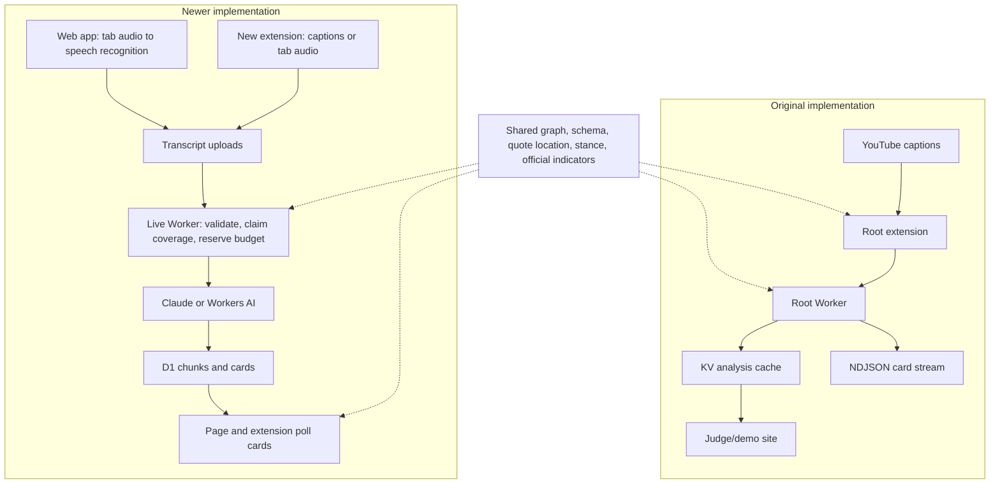

# Lastro codebase guide

Inspected on 2026-11-12 at commit `b5c2ac2`. This is a source-backed onboarding snapshot. Recheck the linked code when changing behavior; build success and recorded evaluations establish only the checks described below.

## What the product does

Lastro helps a viewer understand economic and political claims in a YouTube video. It places context cards on the playback timeline: the speaker's claim, its intellectual background, opposing views, relevant Brazilian episodes, readings, and comparisons with official figures. A theory or forecast has no truth verdict. Numerical comparisons use official data and say whether values match or differ.

Read the [domain glossary](../GLOSSARY.md) for the product language. There are two executable implementations in this repository. They share domain code but have different ingestion, persistence, and delivery contracts.

| Area | Original implementation | Newer live implementation |
| --- | --- | --- |
| User surfaces | Root Chrome extension and judge/demo site | Web app, landing/privacy pages, and another Chrome extension |
| Entry points | [`extension/src/content.ts`](../extension/src/content.ts), [`site/src/demo.ts`](../site/src/demo.ts) | [`webapp/src/web/main.ts`](../webapp/src/web/main.ts), [`webapp/extension/src/content.ts`](../webapp/extension/src/content.ts) |
| Backend | [`worker/src/index.ts`](../worker/src/index.ts) | [`webapp/src/worker/index.ts`](../webapp/src/worker/index.ts) |
| Input | A video's captions | Live recognized speech, or captions from the newer extension |
| Analysis | One streamed Claude call for the supplied transcript | Calls per chunk; Claude first, Workers AI fallback |
| Persistence | Cloudflare KV, keyed by video + transcript hash + prompt version | Cloudflare D1, shared by video and covered time buckets |
| Delivery | NDJSON stream and cached results | Incremental card polling; transcript request waits for its chunk's processing |
| Default local port | 8787 | 8788 |

The [newer app README](../webapp/README.md#chrome-extension) describes its extension as replacing the first extension for that app. Recent commits concentrate on this implementation. **Inference:** `webapp/` is the likely starting point for new product work. Whether both implementations must remain supported is still a maintainer decision.

## Trace the newer implementation

1. The page opens a video and polls stored cards. Language detection uses the video's original audio metadata, automatic captions, or title, with viewer/browser choices as fallbacks. See [`main.ts`](../webapp/src/web/main.ts), [`language.ts`](../webapp/src/worker/language.ts), and [`youtube.ts`](../webapp/src/web/youtube.ts).
2. Listening creates a video-bound session, captures tab audio, and uses Chrome speech recognition. [`transcriber.ts`](../webapp/src/web/transcriber.ts) maps recognized phrases to playback times. [`uploader.ts`](../webapp/src/web/uploader.ts) buffers final segments: first scheduled flush at 15 seconds, then every 30 seconds, or earlier at its character threshold.
3. The newer extension reuses the page's overlay, timeline, speech helpers, and uploader. It mounts into YouTube through a shadow root. Its page-world hook/panel readers obtain captions; [`captions.ts`](../webapp/extension/src/captions.ts) chunks uncovered captions and prioritizes the playhead. The background worker proxies requests to the configured backend. An offscreen document supports explicit tab-audio listening when captions are unavailable. See [`messages.ts`](../webapp/extension/src/messages.ts) for message contracts.
4. The live Worker validates and cleans segments, checks session lifetime and pacing, and claims coverage in D1. Coverage uses **10-second buckets of segment start times**, with `(video_id, bucket)` unique. These are approximate coverage markers, rather than a precise union of every segment's duration.
5. For newly claimed text, the Worker reserves daily dollars or neurons, then calls [`factcheck.ts`](../webapp/src/worker/factcheck.ts). The model receives new speech, preceding context, and recent recorded ideas. Validation locates each quote in the new transcript and constrains card fields. Cards can survive without a graph node or official indicator.
6. Fact cards with supported Brazilian indicators are checked against BCB/IBGE data in the Worker. The saved result includes the comparison and a thinned series for charts. A theory, unmatched indicator, or failed lookup can have no verdict. Quote location uses a normalized word-overlap heuristic in [`locate.ts`](../shared/locate.ts); it is not proof of exact sequence or of what was actually spoken.
7. Claude cards are saved as completed units arrive. Workers AI cards are saved after its response is parsed. The transcript endpoint holds its response open while processing and also registers the work with `waitUntil`. Card delivery to clients remains polling: roughly 3 seconds while active, 30 seconds while idle. Hidden-tab behavior allows continued polling while listening.

### Live interfaces and stored data

The contract types are in [`webapp/src/types.ts`](../webapp/src/types.ts); routing, validation, SQL, budgets, and chunk orchestration currently share [`webapp/src/worker/index.ts`](../webapp/src/worker/index.ts).

| Interface | Purpose |
| --- | --- |
| `GET /api/videos` | Public recent-analysis history, up to 24 videos |
| `POST /api/videos/:id/sessions` | Creates a 2-hour token for speech or captions ingestion |
| `POST /api/videos/:id/transcript` | Submits segments, processes newly claimed text, reports accepted/skipped counts |
| `GET /api/videos/:id/cards?after=<cursor>` | Up to 100 new stored cards per poll, cursor, recent chunk status, coverage estimate |
| `GET /api/videos/:id/coverage` | Merged bucket ranges, used to avoid resending captions |
| `GET /api/videos/:id/language` | Detects and caches spoken language |

Seven ordered [SQL migrations](../webapp/migrations/) define:

| Table | Responsibility |
| --- | --- |
| `videos` | Metadata, cached language, analysis counters, history timestamp |
| `chunks` | Accepted text, processing state, provider, recorded usage/error |
| `coverage` | First claimant for each video/time bucket |
| `cards` | JSON card payloads with video, chunk, start time, and increasing id |
| `sessions` | Hashed token, video, source, hashed connection, pacing counters |
| `daily_videos` | Tracks first analysis of each video on each UTC day and connection attribution |
| `usage_daily` | Daily reserved/settled dollars and neurons |
| `transcript_log` | Cleaned uploads and their outcomes for investigation |

This is a shared-video system. There is no implemented user account or personal library. Sessions authorize ingestion for a video; they do not establish transcript provenance. The first accepted transcript for a covered bucket becomes the shared input even if another viewer would supply different text.

Cleanup for expired sessions, previous daily-video records, and old transcript-log rows runs when creating a session. `LOG_RETENTION_DAYS` applies to `transcript_log`; `chunks.segments` also retains accepted text, with no corresponding age-based deletion in this Worker. A retention change must account for both stores.

### Integration boundaries

| Dependency | Where it connects | What to verify before changing it |
| --- | --- | --- |
| YouTube | IFrame player, page hooks/panel readers, Worker oEmbed/watch-page fetches | Playback clock, navigation/ad handling, missing captions, language metadata failures |
| Chrome speech/capture | Web transcriber, extension background/offscreen document | User gesture and permissions, language, interruption/restart, time alignment |
| Anthropic | Both Workers; newer extraction in `factcheck.ts` | Structured output, streaming partial results, quote validation, provider failure, usage settlement |
| Workers AI | Newer `factcheck.ts` | Alternative response shapes, truncation, neuron reservation, fallback exhaustion |
| BCB and IBGE | [`shared/indicators.ts`](../shared/indicators.ts) | Indicator meaning/unit, period selection, comparison tolerance, missing/slow data |
| Cloudflare D1 | Live Worker and migrations | Uniqueness, concurrency, failure recovery, ordering/cursors, data migration |
| Cloudflare KV | Original Worker | Cache compatibility, prompt version, counters and pending keys |

Provider/model names and pricing in source describe this checkout's configuration. Their current availability, limits, and commercial prices were not independently verified during onboarding.

## Trace the original implementation

[`extension/src/content.ts`](../extension/src/content.ts) obtains captions via its hook/panel readers, classifies the video, hashes the transcript, and asks the background worker for a cache lookup. On a miss it requests analysis; a manual override can bypass topic rejection under a separate cap.

The root Worker independently checks the hash and topic, reads KV limits, calls Claude with [`shared/prompt.ts`](../shared/prompt.ts), validates located cards, and streams `meta`, `card`, `enrich`, `dropped`, `done`, or `error` events. Prompt `p9` adds context and counterpoints after units. Cached analyses replay as a stream. The original extension fetches official data in its background worker, with a six-hour in-memory cache.

The demo site reuses the original overlay with a YouTube IFrame player. Recorded demo cards ship as fallbacks; the live demo endpoint makes a fresh model call. Start from [`shared/demo.ts`](../shared/demo.ts), [`site/src/demo.ts`](../site/src/demo.ts), and the root Worker's `/api/demo/*` routes.

Important difference: original KV spending/daily/pending counters use read-then-write operations. They do not provide the live implementation's atomic SQL reservations. Treat concurrency and spending guarantees separately for each backend.

## Where changes belong

| Change | First files to read | Likely reach |
| --- | --- | --- |
| Add intellectual context or an opposing view | [`shared/kg.json`](../shared/kg.json), [`kg.ts`](../shared/kg.ts), [`stance.ts`](../shared/stance.ts) | Both implementations; model prompt context and rendered reading/opposition sections |
| Change card kinds or supported indicators | [`shared/schema.ts`](../shared/schema.ts), [`indicators.ts`](../shared/indicators.ts), both model validators | Both implementations, stored cards, output schemas, fixtures |
| Improve live extraction or add another model | [`webapp/src/worker/factcheck.ts`](../webapp/src/worker/factcheck.ts), live Worker budget/runner functions | Web app and newer extension |
| Change original extraction/enrichment | [`shared/prompt.ts`](../shared/prompt.ts), root Worker, `PROMPT_VERSION` | Original stream/cache and demo; shared schema changes can also affect live output |
| Change live card UI or popup timing | [`webapp/src/web/overlay.ts`](../webapp/src/web/overlay.ts), [`cardview.ts`](../webapp/src/web/cardview.ts), [`timeline.ts`](../webapp/src/web/timeline.ts) | Page and newer extension; original UI is a separate implementation |
| Change transcript ingestion/retries | [`uploader.ts`](../webapp/src/web/uploader.ts), extension [`captions.ts`](../webapp/extension/src/captions.ts), live Worker | Different pacing and coverage expectations for speech/captions |
| Change topic gating | [`shared/topics.ts`](../shared/topics.ts), both extension content scripts, root Worker | Client gating in extensions; server gating in original Worker; no equivalent topic gate in live transcript endpoint |
| Add persistent behavior | [`webapp/migrations/`](../webapp/migrations/), live Worker, [`types.ts`](../webapp/src/types.ts) | D1 migration, contract, and client behavior |

Existing useful test seams include `stanceView`, transcript parsing/quote location, `TranscriptUploader`'s `Transport`, the timeline's `PlayerAdapter`, and the Worker's request/response interface. The live Worker currently creates model/data dependencies internally and combines several responsibilities; introduce an interface only when the feature or a specific behavioral test needs it.

## Verified implementation state

The working tree was clean before onboarding. Latest inspected change: merge of the newer extension/live-overlay work on 2026-11-10. The implementation is a substantial prototype with buildable surfaces and shared-domain regression checks. Production readiness and hosted service health remain unestablished by this assessment.

Run from the root unless the command names a workspace:

| Check run on 2026-11-12 | Result | What it establishes |
| --- | --- | --- |
| `pnpm install --frozen-lockfile` | Passed | Pinned workspace dependencies install with the existing lockfile |
| `pnpm run typecheck` | Passed | Root shared/Worker/scripts and original extension compile |
| `pnpm --filter lastro-live run typecheck` | Passed | Live Worker, web client, and newer extension compile |
| `pnpm run eval` | 770 passed, 0 failed | Stance, recorded model labels/enrichment, graph rules, synthetic transcript-panel parsing |
| `pnpm run build:ext` | Passed | Original extension bundles |
| `pnpm run build:site` | Passed | Original demo site bundles |
| `pnpm --filter lastro-live run build` | Passed | Live Worker and three web pages bundle |
| `pnpm --filter lastro-live run ext:build` | Passed | Newer extension bundles |
| `pnpm --filter lastro-live run db:local` | Seven migrations applied | Schema applies to a fresh local D1 database |

Not exercised: browser playback/capture/extension installation, live inference/fallback, public data API availability, deployed D1/KV, production usage limits under load, and classifier retraining/parity. The existing evaluation does not re-run a model or test the live ingestion lifecycle. There is no checked-in CI workflow or dedicated live integration/browser test suite in this snapshot.

## Gaps and decisions to keep visible

| Finding | Evidence and implication |
| --- | --- |
| Main product target is implicit | Two Workers, two extensions, separate protocols/storage. Confirm whether new work targets `webapp/` alone or both before estimating a feature. |
| Root overview is historical | Root README status reports 22 nodes; checked-in graph/evaluation has 36 nodes and 50 edges. The new guide is linked from the root to expose both implementations. |
| Deployment configuration is incomplete in this checkout | Root production KV id and live D1 id are placeholders. The live README says its D1 id is already present. This cannot establish whether a separately configured deployment exists. |
| Newer extension defaults to a hosted backend | [`webapp/extension/build.mjs`](../webapp/extension/build.mjs) defaults to `https://lastro.lovu.club`. A local backend requires an explicit build override. That URL was not probed. |
| Persisted cards lack analysis-version identity in live D1 | Original cache includes transcript hash and prompt version; live coverage/cards do not have an equivalent prompt-version key. Decide reprocessing, invalidation, and provenance semantics when changing prompts or sources. |
| Live schema differs from original p9 | Live adds an optional stored headline and removes `notes` from requested model output. Shared schema changes need checks of both contracts. |
| Some runtime details contradict prose | Live timeline constant is a 20-second popup gap although its comment/README mention 40; code polls at 3 seconds while an older costs paragraph says 5. Read current constants for behavior. |
| Trust and retention need explicit product policy | Video-bound public uploads, first-claim coverage, shared history, retained chunk text, and partial-result behavior affect integrations and moderation. Existing docs acknowledge invented-transcript risk. |
| Budget bookkeeping has limits | Live code acknowledges that a failed Claude call with no saved cards can cost money while its reservation is refunded. KV counters have separate concurrency limitations. A configured cap alone is not evidence of an absolute billing ceiling. |
| Training is not reproducible from tracked files alone | Classifier raw text is intentionally ignored; parity reads `data/classifier/raw/*`. `topics:train` also assumes a Unix-style virtualenv Python path. Runtime scoring uses the committed model. |

No roadmap or new architecture decision is implied by this list. It separates known implementation facts from choices that require a maintainer.

## A practical ownership path

1. Explain one card from transcript to screen using the numbered live flow, then trace it in the linked files.
2. Run the offline checks above. For interactive setup, use [the live app instructions](../webapp/README.md#run-locally) or [the original extension instructions](../README.md#install-and-try-it-step-by-step). Live local inference uses real provider accounts.
3. Read one recorded stream beside its gold expectations: [`TESTfacts01.ndjson`](../fixtures/streams/TESTfacts01.ndjson) and [`TESTfacts01.json`](../eval/gold/TESTfacts01.json). Separate deterministic card policy from model quality.
4. Choose a small behavior you want to change and follow the [development workflow](development-workflow.md). Begin with the user-visible scenario, target implementation, and a test seam.

Useful questions for an agent: “Trace why this card got this opposing view,” “Which behavior differs between the two implementations?”, “What would a new transcript source have to guarantee?”, and “Which of this feature's assumptions are enforced by code?” Ask for source references and a distinction between observed behavior and proposals.
