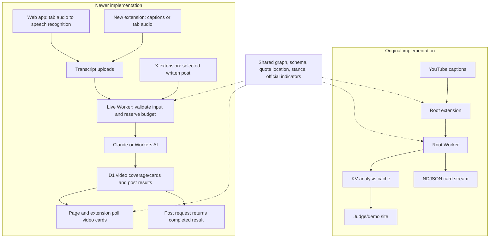

# Lastro codebase guide

This guide maps the two implementations and their change boundaries. Verify the linked source when changing behavior. Feature contracts live under `docs/features/`; setup and verification are described in [Contributing](../CONTRIBUTING.md).

## What the product does

Lastro helps a viewer understand economic and political claims in a YouTube video. It places context cards on the playback timeline: the speaker's claim, its intellectual background, opposing views, relevant Brazilian episodes, readings, and comparisons with official figures. A theory or forecast has no truth verdict. Numerical comparisons use official data and say whether values match or differ.

The newer extension also contextualizes selected Portuguese X posts across home, detail, search, and profile feeds. Its source isolation, presentation, reuse, comparison policy, and limitations are maintained in the [X feature document](features/x/README.md).

Read the [domain glossary](../GLOSSARY.md) for the product language. There are two executable implementations in this repository. They share domain code but have different ingestion, persistence, and delivery contracts.

| Area | Original implementation | Newer live implementation |
| --- | --- | --- |
| User surfaces | Root Chrome extension and judge/demo site | Web app, landing/privacy pages, and another Chrome extension |
| Entry points | [`extension/src/content.ts`](../extension/src/content.ts), [`site/src/demo.ts`](../site/src/demo.ts) | [`webapp/src/web/main.ts`](../webapp/src/web/main.ts), YouTube [`content.ts`](../webapp/extension/src/content.ts), X [`x-content.ts`](../webapp/extension/src/x-content.ts) |
| Backend | [`worker/src/index.ts`](../worker/src/index.ts) | [`webapp/src/worker/index.ts`](../webapp/src/worker/index.ts) |
| Input | A video's captions | Live recognized speech, captions, or selected complete authored X post text |
| Analysis | One streamed Claude call for the supplied transcript | Calls per video chunk or selected post; Claude first, Workers AI fallback |
| Persistence | Cloudflare KV, keyed by video + transcript hash + prompt version | Cloudflare D1: video coverage/cards and separate post results |
| Delivery | NDJSON stream and cached results | Video card polling; post request returns its completed result |
| Default local port | 8787 | 8788 |

Active feature development targets `webapp/`. The original implementation remains in the repository; retiring or migrating it is a separate decision. Shared-domain changes still need verification of both consumers.

## Trace the newer implementation

1. The page opens a video and polls stored cards. Language detection uses the video's original audio metadata, automatic captions, or title, with viewer/browser choices as fallbacks. See [`main.ts`](../webapp/src/web/main.ts), [`language.ts`](../webapp/src/worker/language.ts), and [`youtube.ts`](../webapp/src/web/youtube.ts).
2. Listening creates a video-bound session, captures tab audio, and uses Chrome speech recognition. [`transcriber.ts`](../webapp/src/web/transcriber.ts) maps recognized phrases to playback times. [`uploader.ts`](../webapp/src/web/uploader.ts) buffers final segments: first scheduled flush at 15 seconds, then every 30 seconds, or earlier at its character threshold.
3. The newer extension reuses the page's overlay, timeline, speech helpers, and uploader. It mounts into YouTube through a shadow root. Its page-world hook/panel readers obtain captions; [`captions.ts`](../webapp/extension/src/captions.ts) chunks uncovered captions and prioritizes the playhead. The background worker proxies requests to the configured backend. An offscreen document supports explicit tab-audio listening when captions are unavailable. See [`messages.ts`](../webapp/extension/src/messages.ts) for message contracts.
4. The live Worker validates and cleans segments, checks session lifetime and pacing, and claims coverage in D1. Coverage uses **10-second buckets of segment start times**, with `(video_id, bucket)` unique. These are approximate coverage markers, rather than a precise union of every segment's duration.
5. For newly claimed text, the Worker reserves daily dollars or neurons, then calls [`factcheck.ts`](../webapp/src/worker/factcheck.ts). The model receives new speech, preceding context, and recent recorded ideas. Validation locates each quote in the new transcript and constrains card fields. Cards can survive without a graph node or official indicator.
6. Fact cards with supported Brazilian indicators are checked against BCB/IBGE data in the Worker. The saved result includes the comparison and a thinned series for charts. A theory, unmatched indicator, or failed lookup can have no verdict. Quote location uses a normalized word-overlap heuristic in [`locate.ts`](../shared/locate.ts); it is not proof of exact sequence or of what was actually spoken.
7. Claude cards are saved as completed units arrive. Workers AI cards are saved after its response is parsed. The transcript endpoint holds its response open while processing and also registers the work with `waitUntil`. Card delivery to clients remains polling: roughly 3 seconds while active, 30 seconds while idle. Hidden-tab behavior allows continued polling while listening.

### Live interfaces and stored data

The contract types are in [`webapp/src/types.ts`](../webapp/src/types.ts); routing, validation, SQL, budgets, and chunk orchestration currently share [`webapp/src/worker/index.ts`](../webapp/src/worker/index.ts).

| Interface | Purpose |
| --- | --- |
| `GET /api/videos` | Public recent-analysis history, up to 24 videos |
| `POST /api/videos/:id/sessions` | Creates a 2-hour token for speech or captions ingestion |
| `POST /api/videos/:id/transcript` | Submits segments, processes newly claimed text, reports accepted/skipped counts |
| `GET /api/videos/:id/cards?after=<cursor>` | Up to 100 new stored cards per poll, cursor, recent chunk status, coverage estimate |
| `GET /api/videos/:id/coverage` | Merged bucket ranges, used to avoid resending captions |
| `GET /api/videos/:id/language` | Detects and caches spoken language |
| `POST /api/posts/analyze` | Validates a complete Portuguese public-post observation; reuses a compatible result or analyzes and saves `complete`/`empty`; competing requests receive 409 `in_progress` with Retry-After |
| `GET /api/posts/results/:id` | Retrieves one saved post result by its opaque result id; no public post-history listing |

Ordered [SQL migrations](../webapp/migrations/) define:

| Table | Responsibility |
| --- | --- |
| `videos` | Metadata, cached language, analysis counters, history timestamp |
| `chunks` | Accepted text, processing state, provider, recorded usage/error |
| `coverage` | First claimant for each video/time bucket |
| `cards` | JSON card payloads with video, chunk, start time, and increasing id |
| `sessions` | Hashed token, video, source, hashed connection, pacing counters |
| `daily_videos` | Tracks first analysis of each video on each UTC day and connection attribution |
| `usage_daily` | Daily reserved/settled dollars and neurons |
| `transcript_log` | Cleaned uploads and their outcomes for investigation |
| `post_results` | Migration [`0008_posts.sql`](../webapp/migrations/0008_posts.sql): authored source metadata/text, successful cards or explicit empty outcome, opaque result id and analysis time |
| `post_analysis_keys` | Migration [`0009_post_reuse.sql`](../webapp/migrations/0009_post_reuse.sql): post identity, server text/metadata fingerprints, contract version, successful result reference and temporary attempt lease |

Video ingestion is a shared-video system. There is no implemented user account or personal library. Sessions authorize ingestion for a video; they do not establish transcript provenance. The first accepted transcript for a covered bucket becomes the shared input even if another viewer would supply different text. Post requests create no video, session, coverage, transcript-log or public recent-history rows. Post reuse is shared across viewers, with no viewer identifier in its lookup key.

Cleanup for expired sessions, previous daily-video records, and old transcript-log rows runs when creating a session. `LOG_RETENTION_DAYS` applies to `transcript_log`; `chunks.segments` also retains accepted text, with no corresponding age-based deletion in this Worker. A retention change must account for both stores.

### Trace the X post interaction

1. [`x-content.ts`](../webapp/extension/src/x-content.ts) observes source articles,
   applies the local relevance/source gate, and re-reads the selected complete
   post when the viewer clicks Lastro.
2. The [background transport](../webapp/extension/src/background.ts) proxies
   `PostSource` to the [Worker](../webapp/src/worker/index.ts). Post contracts
   are separate from transcript sessions and video coverage.
3. [`post-cache.ts`](../webapp/src/worker/post-cache.ts) computes compatibility
   fingerprints and claims attempts in D1. [`posts.ts`](../webapp/src/worker/posts.ts)
   extracts and grounds authored claims; [`post-comparisons.ts`](../webapp/src/worker/post-comparisons.ts)
   applies supported historical official-data policy. Successful cards and empty
   results are reusable; failures remain retryable.
4. The [extension UI](../webapp/extension/src/), reached from the X content entry,
   provides the nonmodal reading panel. Shared [`cardview.ts`](../webapp/src/web/cardview.ts) renders
   attributed context without adding video seeking to post cards.

The [X feature contract](features/x/README.md) is the single source for accepted
behavior and decision rationale. DOM observation is not platform attestation;
post compatibility, presentation cleanup, and date policy each have their own
test cases linked there.

### Integration boundaries

| Dependency | Where it connects | What to verify before changing it |
| --- | --- | --- |
| YouTube | IFrame player, page hooks/panel readers, Worker oEmbed/watch-page fetches | Playback clock, navigation/ad handling, missing captions, language metadata failures |
| X rendered pages | [`x-content.ts`](../webapp/extension/src/x-content.ts), extension manifest/background transport | Selected-post identity, author/public/protected observations, own text/quote exclusion, truncation, DOM changes and inline placement |
| Chrome speech/capture | Web transcriber, extension background/offscreen document | User gesture and permissions, language, interruption/restart, time alignment |
| Anthropic | Both Workers; newer video extraction in `factcheck.ts`, authored-post extraction in `posts.ts` | Structured output, streaming partial video results, quote validation, provider failure, usage settlement |
| Workers AI | Newer `factcheck.ts` and `posts.ts` | Alternative response shapes, truncation, neuron reservation, fallback exhaustion |
| BCB and IBGE | [`shared/indicators.ts`](../shared/indicators.ts), post-only [`post-comparisons.ts`](../webapp/src/worker/post-comparisons.ts) | Indicator meaning/unit, period selection versus release/vintage, comparison tolerance, missing/slow data |
| Cloudflare D1 | Live Worker and migrations | Uniqueness, concurrency, failure recovery, ordering/cursors, data migration |
| Cloudflare KV | Original Worker | Cache compatibility, prompt version, counters and pending keys |

Provider/model names and pricing in source describe this checkout's configuration. Their current availability, limits, and commercial prices were not independently verified during onboarding.

## Trace the original implementation

[`extension/src/content.ts`](../extension/src/content.ts) obtains captions via its hook/panel readers, classifies the video, hashes the transcript, and asks the background worker for a cache lookup. On a miss it requests analysis; a manual override can bypass topic rejection under a separate cap.

The root Worker independently checks the hash and topic, reads KV limits, calls Claude with [`shared/prompt.ts`](../shared/prompt.ts), validates located cards, and streams `meta`, `card`, `enrich`, `dropped`, `done`, or `error` events. Prompt `p9` adds context and counterpoints after units. Cached analyses replay as a stream. The original extension fetches official data in its background worker, with a six-hour in-memory cache.

The demo site reuses the original overlay with a YouTube IFrame player. Recorded demo cards ship as fallbacks; the live demo endpoint makes a fresh model call. Start from [`shared/demo.ts`](../shared/demo.ts), [`site/src/demo.ts`](../site/src/demo.ts), and the root Worker's `/api/demo/*` routes.

Important difference: original KV spending/daily/pending counters use read-then-write operations. They do not provide the live implementation's atomic SQL reservations. Treat concurrency and spending guarantees separately for each backend.

## Where changes belong

| Change | First files to read | Likely reach |
| --- | --- | --- |
| Add intellectual context or an opposing view | [`shared/kg.json`](../shared/kg.json), [`kg.ts`](../shared/kg.ts), [`stance.ts`](../shared/stance.ts) | Both implementations; model prompt context and rendered reading/opposition sections |
| Change card kinds or supported indicators | [`shared/schema.ts`](../shared/schema.ts), [`indicators.ts`](../shared/indicators.ts), both model validators | Both implementations, stored cards, output schemas, fixtures |
| Improve live extraction or add another model | [`webapp/src/worker/factcheck.ts`](../webapp/src/worker/factcheck.ts), live Worker budget/runner functions | Web app and newer extension |
| Change authored-post extraction or outcomes | [`webapp/src/worker/posts.ts`](../webapp/src/worker/posts.ts), [`post-cache.ts`](../webapp/src/worker/post-cache.ts), post routes in [`index.ts`](../webapp/src/worker/index.ts), [`types.ts`](../webapp/src/types.ts) | Post prompt/validation, analysis version, storage contract and Worker request/response tests |
| Change selected X post interaction | [`x-content.ts`](../webapp/extension/src/x-content.ts), shared [`cardview.ts`](../webapp/src/web/cardview.ts) | Local relevance/source observation, extraction, panel lifecycle and Chrome fixture checks |
| Change original extraction/enrichment | [`shared/prompt.ts`](../shared/prompt.ts), root Worker, `PROMPT_VERSION` | Original stream/cache and demo; shared schema changes can also affect live output |
| Change live card UI or popup timing | [`webapp/src/web/overlay.ts`](../webapp/src/web/overlay.ts), [`cardview.ts`](../webapp/src/web/cardview.ts), [`timeline.ts`](../webapp/src/web/timeline.ts) | Page and newer extension; original UI is a separate implementation |
| Change transcript ingestion/retries | [`uploader.ts`](../webapp/src/web/uploader.ts), extension [`captions.ts`](../webapp/extension/src/captions.ts), live Worker | Different pacing and coverage expectations for speech/captions |
| Change topic gating | [`shared/topics.ts`](../shared/topics.ts), both extension content scripts, root Worker | Client gating in extensions; server gating in original Worker; no equivalent topic gate in live transcript endpoint |
| Add persistent behavior | [`webapp/migrations/`](../webapp/migrations/), live Worker, [`types.ts`](../webapp/src/types.ts) | D1 migration, contract, and client behavior |

Existing useful test seams include `stanceView`, transcript parsing/quote location, `TranscriptUploader`'s `Transport`, the timeline's `PlayerAdapter`, and the Worker's request/response interface. The live Worker currently creates model/data dependencies internally and combines several responsibilities; introduce an interface only when the feature or a specific behavioral test needs it.

## Verification boundaries

Use [Contributing](../CONTRIBUTING.md#verification) for checks by change area and
record results in the relevant issue or PR. Builds, controlled tests, real
providers, and live browser checks establish different things.

- The shared evaluation exercises stance, recorded model output, graph rules,
  and transcript-panel parsing without rerunning a model or live ingestion.
- [Worker checks](../webapp/tests/posts-worker.test.mjs) exercise requests,
  isolated D1, reuse/concurrency, validation, comparison policy, and budgets with
  controlled external inputs.
- [Extension checks](../webapp/tests/posts-extension.test.mjs) exercise fixture
  source extraction, UI/lifecycle, and newer YouTube saved-card display/seeking.
  Fixtures do not establish ongoing compatibility with live X markup, real
  playback/capture, or model quality. The small Portuguese sample is a
  development sanity check, not an independent accuracy benchmark.
- Deployed storage, provider fallback, billing behavior under load, public-data
  availability, and classifier retraining need their own runtime evidence.

## Gaps and decisions to keep visible

| Finding | Evidence and implication |
| --- | --- |
| Two implementations remain | The X POC explicitly targets `webapp/`. When a task touches shared behavior, account for both implementations; their protocols and storage differ. |
| Deployment configuration is incomplete in this checkout | Root production KV id and live D1 id are placeholders. These placeholders support local development but do not describe any separately configured deployment. |
| Newer extension defaults to a hosted backend | [`webapp/extension/build.mjs`](../webapp/extension/build.mjs) defaults to `https://lastro.lovu.club`. A local backend requires an explicit build override. That URL was not probed. |
| Persisted video cards lack analysis-version identity in live D1 | Original cache includes transcript hash and prompt version; live video coverage/cards do not have an equivalent key. Post reuse separately includes text, metadata and analysis version. |
| Live schema differs from original p9 | Live adds an optional stored headline and removes `notes` from requested model output. Shared schema changes need checks of both contracts. |
| Some runtime details contradict prose | Live timeline constant is a 20-second popup gap although its comment/README mention 40; code polls at 3 seconds while an older costs paragraph says 5. Read current constants for behavior. |
| Trust and retention need explicit product policy | Video-bound public uploads, first-claim coverage, shared history, retained chunk text, and partial-result behavior affect integrations and moderation. Existing docs acknowledge invented-transcript risk. |
| Budget bookkeeping has limits | Live code acknowledges that a failed Claude call with no saved cards can cost money while its reservation is refunded. KV counters have separate concurrency limitations. A configured cap alone is not evidence of an absolute billing ceiling. |
| Training is not reproducible from tracked files alone | Classifier raw text is intentionally ignored; parity reads `data/classifier/raw/*`. `topics:train` also assumes a Unix-style virtualenv Python path. Runtime scoring uses the committed model. |
| X public-state assumptions need live evidence | The source gate requires complete recognized metadata and skips known protected markers, but this browser observation is not platform attestation. Deterministic fixtures do not verify real X markup or public status. |
| Post integration remains a POC | The four-surface post flow, compatible shared reuse and conservative historical official comparisons have controlled regression coverage. Full live surface/lifecycle and public-state acceptance require evidence beyond controlled fixtures. |

No roadmap or new architecture decision is implied by this list. It separates known implementation facts from choices that require a maintainer.
