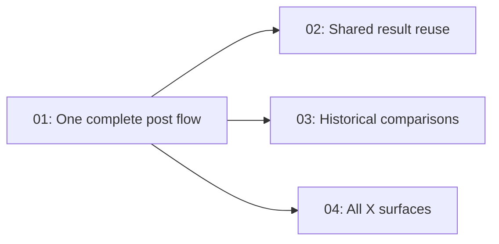

# X integration: approved ticket breakdown

Status: approved by the maintainer's overnight implementation request. GitHub publication is performed by `node scripts/publish-x-issues.mjs`; actual issue URLs are recorded in `docs/features/x-integration-issues.json` after verification.

Parent: [X post context: Portuguese POC](../x-integration-spec.md).

Published parent spec: [#2](https://github.com/luanpbrasil/lastro/issues/2). Tickets: [01 / #3](https://github.com/luanpbrasil/lastro/issues/3), [02 / #4](https://github.com/luanpbrasil/lastro/issues/4), [03 / #5](https://github.com/luanpbrasil/lastro/issues/5), [04 / #6](https://github.com/luanpbrasil/lastro/issues/6). Each is labeled `ready-for-agent`; native sub-issue/blocking relationships and explicit body links were configured during publication.

Implementation-agent preference: GPT-6 Astra (`gpt-6-astra`). The user authorized sequential execution in order **01, 02, 03, 04** on the existing feature branch, followed by push and one PR. Use fresh implementation context per ticket with pointers to the parent spec, selected ticket, and codebase guide. See [the overnight instructions](../../agents/x-overnight-run.md). Images/video remain feasibility research, outside this accepted text-post POC.

| Ticket | Blocked by | Demoable behavior |
| --- | --- | --- |
| [01: Contextualize one public post](01-contextualize-one-post.md) | None | From an individual post page, click Lastro and receive attributed context, an explicit empty result, or an error with Retry |
| [02: Reuse unchanged public-post results](02-reuse-unchanged-results.md) | 01 | Another viewer receives a compatible saved result; edits get fresh analysis; X activity stays out of public history |
| [03: Compare numerical claims for the right date](03-date-aware-comparisons.md) | 01 | A post's dated numerical claim receives the appropriate official comparison, with ambiguous cases left unchecked |
| [04: Bring the interaction to all four X surfaces](04-all-x-surfaces.md) | 01 | The interaction works on home, search, and profiles as well as post detail, with a quiet local relevance filter |

Ticket 01 supplies the first end-to-end path. Until ticket 03, numerical facts can be displayed without a verdict. Ticket 02 adds shared reuse to that path. Tickets 02–04 all need 01, but do not logically block each other; they may still be worked sequentially on this feature branch.

Each ticket carries its own behavioral checks at the agreed interfaces. Once all four are complete, verify the full POC on all four live surfaces and check the newer YouTube behavior before considering the parent spec delivered. That completion condition does not add an artificial blocking edge between otherwise independent tickets.

The breakdown is approved. Publish issues in blocker-first order with real parent/blocker identifiers; the publication helper preserves explicit body links and configures native relationships when available. A shared feature PR closes the parent and four ticket issues on merge.
